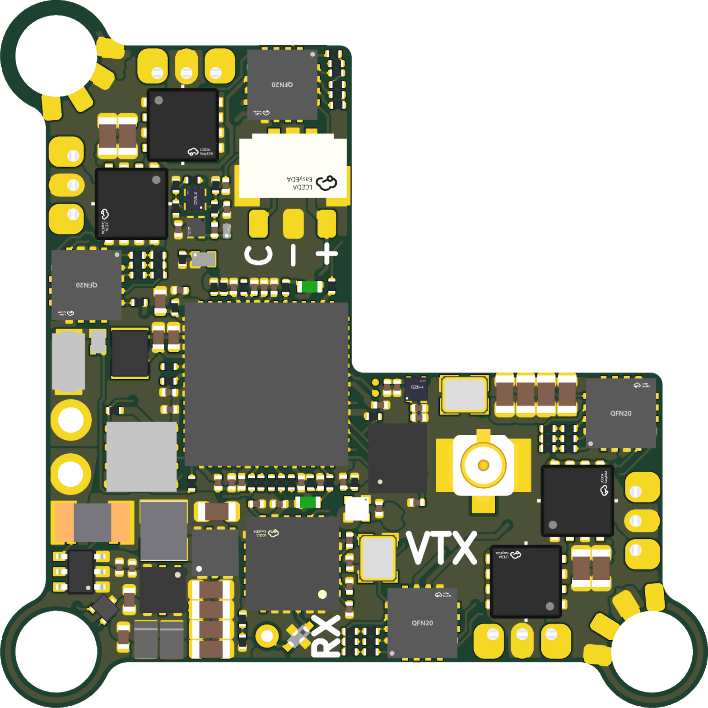
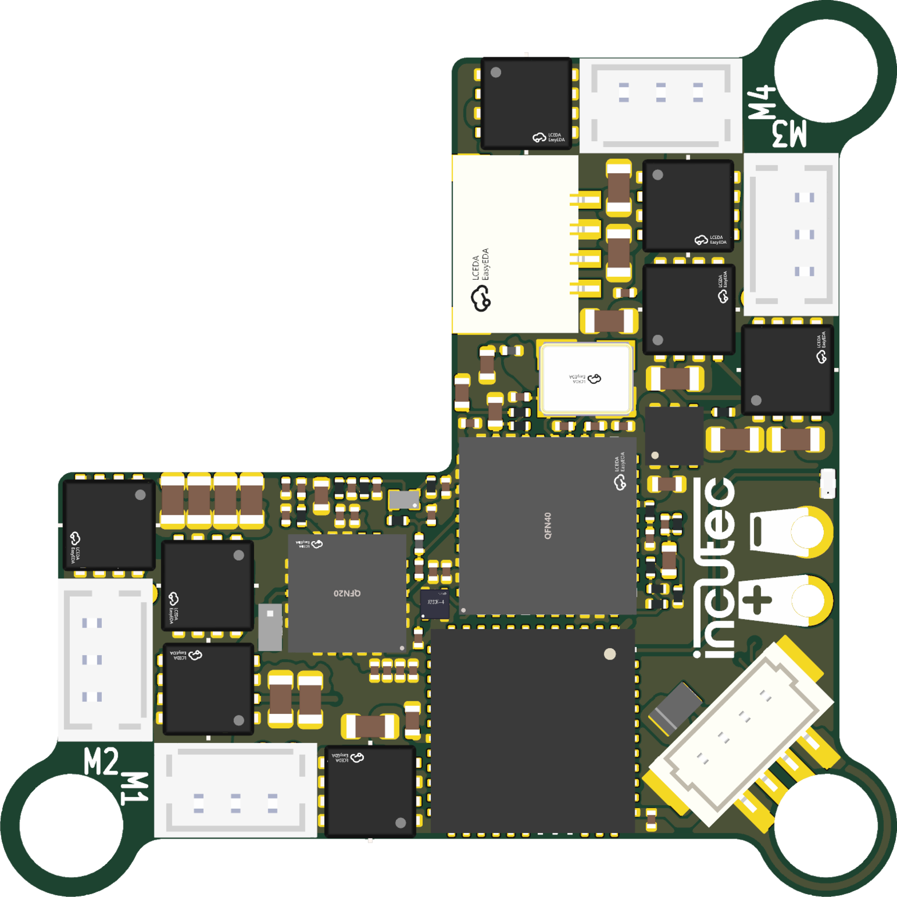

# OpenAIO-Whoop

An all-in-one board for 1S: 65 and 75 mm tiny whoops, 1S toothpicks and 1S
long range on an 18650. Flight controller,
four brushless ESC channels, an ExpressLRS receiver and an onboard analog VTX
on the 25.5 x 25.5 mm whoop mounting pattern. The 1S sibling of
[OpenAIO](https://github.com/OpenDrone-hw/OpenAIO), which covers 3S to 6S on
the same mounting pattern.

<p>


</p>

[](https://github.com/OpenDrone-hw/.github/blob/main/CONTRIBUTING.md#the-life-of-a-project)
[](https://discord.gg/v3sWmTcx3R)

## Why

Whoops are where an AIO is not a convenience but the only option: there is no room for a stack and no weight budget for connectors. 2S and up is OpenAIO's range, so what is left for a second board is 1S, where the power tree starts from a single cell and everything above battery voltage has to be boosted.

Analog is the reason this board is separate rather than a variant. A 1S whoop is the last class still flying analog in volume, and an onboard VTX is what makes the board worth building instead of pointing people at a digital AIO with an HD port.

## Specifications

| | |
|---|---|
| Target class | 1S whoops, 65 to 85 mm |
| Mounting | 25.5 x 25.5 mm, three D3.55 ear holes |
| Board | 26.4 mm body, 8-layer HDI 1+6+1, 0.997 mm |
| Input | 1S LiPo, solder pads J2 (+) and J3 (-) |
| MCU | RP2354A, 2 MB in-package flash |
| IMU | BMI270 on SPI |
| Blackbox | 16 MB SPI NOR flash (PY25Q128HA) |
| ESC | 4 channels, EFM8BB51 + 3 AGM210MAP half-bridges each, bidirectional DShot, Bluejay |
| Current sense | 0.5 mohm shunt + INA186A3, 50 mV/A |
| Receiver | Onboard ExpressLRS 2.4 GHz, ESP32-PICO-V3 + SX1281, wire antenna |
| Video | Onboard analog VTX, RTC6705 + SE5004L PA, U.FL |
| OSD | Analog, PIO framebuffer |
| Digital video | DJI O4 Lite pads: J26 VHD (+5V_BST), J28 TX0, J29 RX0, J27 GND (UART0); JST SH 1.0 mm 4-pin plug J35 (1 VHD, 2 GND, 3 TX, 4 RX) |
| Motors | Molex PicoBlade 1.25 mm 3-pin lands, plug or solder |
| USB | JST SH 1.0 mm 4-pin, J31 |
| Camera | JST SUR 0.8 mm 3-pin plug J32, solder pads J23 and J24 |
| Firmware | Betaflight (target in this repo), Bluejay, ExpressLRS |

Technical write-up, part list and layout constraints: [AGENTS.md](AGENTS.md). Pin map: [research/PINMAP.md](research/PINMAP.md). Firmware: [Betaflight target](firmware/betaflight/README.md), [ExpressLRS binding](firmware/expresslrs/README.md).

Open `hardware/OpenAIO-Whoop.kicad_pro` in KiCad 10 and keep the hardware folder together. The images above are renders of the routed board; this is not a manufacturing release.

## Constraints

- 25.5 x 25.5 mm mounting pattern, shared with OpenAIO.
- 1S only. 2S and above is OpenAIO.
- Motor plugs, USB, battery pads and camera plug follow the BetaFPV Matrix 1S 5IN1 II positions, so leads and cables reach as on that board.
- FC section follows the [OpenFC-Lite-Mini](https://github.com/OpenDrone-hw/OpenFC-Lite-Mini) RP2354A design; receiver follows [OpenRX-Lite-UFL](https://github.com/OpenDrone-hw/OpenRX-Lite-UFL) (SX1281) on an ESP32-PICO-V3 that talks CRSF to the FC and also controls the VTX.
- Passives 0201 and up.
- No battery protection on the board: no reverse-polarity protection, no TVS, no low-cell cutoff.

### VTX control path

| Item | Value |
|---|---|
| Protocol | ExpressLRS MSP-VTX, CRSF receiver on UART1 (GPIO8/9) |
| VTX owner | ESP32-PICO-V3 drives the RTC6705 over SPI and the SE5004L reference through PA_EN (ESP32 GPIO21) |
| Pit mode | Does not drop PA_EN and does not stop SPI activity (see firmware/expresslrs/README.md) |
| HD hold-off | RP2354A GPIO19 (`HD_EN`) high permits analog VTX power, low switches it off; fixed HD builds set `pinio_config = 1,1,1,1` |

## Prior art

- [OpenFC-Lite-Mini](https://github.com/OpenDrone-hw/OpenFC-Lite-Mini) and [OpenRX-Lite-UFL](https://github.com/OpenDrone-hw/OpenRX-Lite-UFL): the FC and RX stages this board follows.
- [OpenAIO](https://github.com/OpenDrone-hw/OpenAIO): the 3S to 6S board on the same mounting pattern.
- [OpenVTX](https://github.com/OpenDrone-hw/OpenVTX): the line's RTC6705 analog VTX.
- BetaFPV Matrix 1S 5IN1 II: the class reference.

## In the line

What pairs with what, and what is available:
[opendrone.be](https://opendrone.be).

## Contributing

See [CONTRIBUTING.md](CONTRIBUTING.md). KiCad files cannot be merged, so say what you intend to change before you do, on [Discord](https://discord.gg/v3sWmTcx3R).

Clone with the shared library:

```sh
git clone --recursive https://github.com/OpenDrone-hw/OpenAIO-Whoop
git submodule update --init      # after a plain git clone
```

Catalogue 3D models resolve through the project text variable `OPENDRONE_LIB` (`${KIPRJMOD}/KiCad-Library`), so without the submodule the 3D view shows bare pads.

A repository holds design files only. Sourcing (suppliers, prices, quotes, RFQs, contacts) is handled by Incutec and never lives in OpenDrone repositories.

## License

Hardware licensed under [CERN-OHL-S-2.0](https://ohwr.org/cern_ohl_s_v2.txt),
see [LICENSE](LICENSE).
