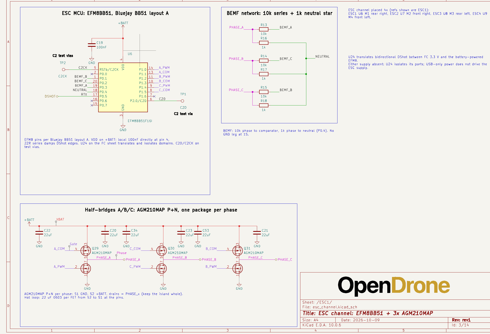
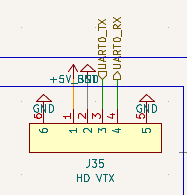
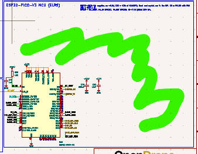
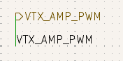
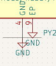

# Schematic review, October 2026

A peer review of the schematic before the board was routed. Check each point against the current design before acting
on it: some may already be resolved. Images are in [`schematic-review-2026-10/`](schematic-review-2026-10/).

| # | Area | Finding |
| --- | --- | --- |
| 1 | Current sensor | Measures up to 66 A, more than needed. Expected load is about 12 A with 16 A burst; a 1 mOhm shunt or the 186A4 would do, though 66 A also works |
| 2 | Parts | Almost everything is TI: reliable but expensive. Component swap suggestions welcome |
| 3 | Regulator | `U2_FB` unconnected on its resistor divider (at least in the schematic) |
| 4 | 5 V supply | The 5 V diode-OR is drawn untidily |
| 5 | Ferrite beads | Unclear whether they are used correctly; a ferrite bead blocks HF noise from an IC polluting the rest of the supply |
| 6 | D11 | Probably unnecessary: datasheet 7.1.4 calls for it "with little or no current" and a "large C_OUT", neither applies here |
| 7 | ESC phase sense | `PHASE_B` routed to `BEMF_C` and `PHASE_C` to `BEMF_B`: on purpose? (possibly an old schematic, see the screenshot below) |
| 8 | ESC gate signals | If `COM` in `A_COM` means an inverted complementary output, the half bridges either short or never connect. If it means the output for the complementary MOSFET (same signal with dead time), it is correct |
| 9 | DShot | The notes mention a 22R series resistor to damp DShot edges, but there is none. The 1k on the RP2350 sheet protects the 3.3 V MCU from the VBAT-powered ESC MCU but may corrupt the bidirectional DShot signal |
| 10 | Labels | A global `SBUS` label on the RP2350 sheet with no visible destination |
| 11 | Labels | `DSHOT` versus `MOTORx_FC` label direction is inconsistent |
| 12 | Receiver | Looks fine |
| 13 | Not reviewed | The rest of the ESC and the RTC6705 video transmitter |
| 14 | Unclear details | The four snippets below were flagged without further comment |

Item 7, the routing as reviewed:

Item 14:

| HD VTX connector J35 | ESP32 sheet | `VTX_AMP_PWM` label | GND pin |
| --- | --- | --- | --- |
|  |  |  |  |
