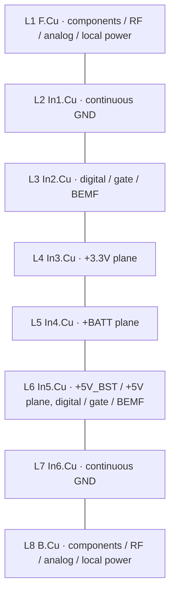

# OpenAIO-Whoop placement and routing reference

The schematic is the electrical source. The PCB contains the matching components,
net assignments, outline, stackup and global rules. It is a placement starting
point: many parts are parked outside the outline, the board carries no tracks or vias,
and local rule areas must be created before routing.
The preserved board is not a routed or manufacturing-ready layout.

## Open the project

Keep the complete folder together. Open `hardware/OpenAIO-Whoop.kicad_pro` in
KiCad 10, then open the schematic and board from that project. Do not open a
child sheet as an independent project. `esc_channel.kicad_sch` is intentionally
instantiated four times.

| File or folder | Purpose |
| --- | --- |
| `hardware/OpenAIO-Whoop.kicad_sch` and all child `.kicad_sch` files | Complete hierarchical schematic |
| `hardware/OpenAIO-Whoop.kicad_pcb` | Synchronized placement starting board |
| `hardware/OpenAIO-Whoop.kicad_pro` | Electrical rules, classes, presets and library path variables |
| `hardware/OpenAIO-Whoop.kicad_dru` | Custom layer, RF and HDI rules; keep beside the project |
| `hardware/lib.kicad_sym` | Project component symbols |
| `hardware/lib.pretty/` | Project footprints |
| `hardware/lib.3dshapes/` | Project 3D models |
| `hardware/KiCad-Library/` | Pinned shared symbols, footprints and models |
| `hardware/sym-lib-table`, `hardware/fp-lib-table` | Project-local library registration |
| `hardware/bom_plan.json` | Generated component index, including MPNs and DNP flags |
| `firmware/` and `research/PINMAP.md` | Checked firmware bindings and pin map |

No global custom-library installation is needed. `OPENDRONE_LIB` resolves to
`${KIPRJMOD}/KiCad-Library`. A Git clone needs its submodule initialized; the
portable handoff includes the shared library files. Stock KiCad libraries are
provided by KiCad 10. Do not move `.pretty`, models or child sheets independently.

## Layer allocation

| Physical layer | KiCad name | Use |
| --- | --- | --- |
| L1 | F.Cu | Top parts; RF, video, gyro and sense traces; short local power loops; digital escapes |
| L2 | In1.Cu | GND reference plane. No tracks. Board 2026-10-15 also carries VBUS, +5V_BST and CSA+ islands (open item) |
| L3 | In2.Cu | Digital signals, regulated supplies, ESC gate and BEMF escapes. No analog or RF |
| L4 | In3.Cu | +3.3V plane and permitted digital signals. No analog, RF, gate, gyro or VTX-control signals |
| L5 | In4.Cu | +BATT plane and permitted digital signals. Same exclusions as L4 |
| L6 | In5.Cu | +5V_BST / +5V split plane; digital signals, ESC gate and BEMF escapes. No analog or RF |
| L7 | In6.Cu | GND reference plane. No tracks. Board 2026-10-15 also carries a VBUS island (open item) |
| L8 | B.Cu | Bottom parts; local RF, video and power loops; short digital connections |

GND zones alone belong on L2 and L7. Keep uninterrupted reference copper under
each RF, USB and video route, directly beneath L1 (L2) and L8 (L7).

GND stitching (2026-10-15, `hardware/tools/gnd_stitch.py`): buried L2-L7 vias on a
2 mm grid plus a fence 0.6 mm inside the outline at 1.2 mm, and F.Cu-L2 / L7-B.Cu
microvias on a 1.2 mm grid, each only where every layer it crosses has room. Track
widths per class: `hardware/tools/track_widen.py` (targets in the script).

The 1.0 mm stackup is in `hardware/tools/stackup.json` and applied to the board
with `hardware/tools/apply_stackup.py`: 1 oz copper on all eight layers, 1080
prepreg 0.077 mm between L1-L2, L2-L3, L6-L7 and L7-L8, 0.20 mm FR4 cores
(0.127 mm dielectric) between L3-L4 and L5-L6, 2116 prepreg 0.125 mm between
L4-L5, total 0.997 mm. The L2-L7 sub-lamination is 0.743 mm. The stored RF
starting geometry is 0.105 mm trace / 0.15 mm coplanar gap, and USB is 0.12 mm
trace / 0.12 mm pair gap. These are design calculations for the recorded
stackup. Fabricator impedance adjustment must use the actual finished copper
and laminate construction. The stackup values are unconfirmed by the fabricator
until it returns its engineering query.

## Place in this order

| Order | Block | Placement requirements |
| --- | --- | --- |
| 1 | Mechanical interfaces | Keep the 25.5 mm three-ear pattern and outline. Position motor lands J4/J7/J10/J13, USB J31, battery J2/J3, camera J32 and antenna interfaces for cable access. Reserve connector mating volumes on both faces |
| 2 | Four ESC cells | For each U6/U7/U8/U9, keep its three AGM210MAP packages and their 22 uF capacitors together on one face. Capacitors bridge source supply and ground at the package lead side. Keep gate loops short; phase copper exits toward the motor lands |
| 3 | Battery shunt and boost | J2 to R2 to the battery distribution should be short and wide. Take both sense traces from the Kelvin lands, outside load-current copper. Place U2/L1/input-output capacitors as a compact loop; keep SW copper small |
| 4 | Two RF chains | Keep U18 to FL1 to AE1 on one face with no RF vias. Keep U19/C110 to U20 to FL2 to J1 on one face. Rotate the whole chain for straight short links; do not retain a parked opposite-face U.FL position |
| 5 | FC and gyro | Place U10 centrally enough to reach the ESCs and peripherals. Place U11 away from boost, PA and motor current, with local C137/C138 and U12/C61/C62. Record the sensor orientation before building final firmware |
| 6 | Receiver and clocks | Keep U16 near U18 with short SPI. Keep X3 and its coupling parts beside U18. Keep X4/C94/C95 beside U19. Keep X1 beside U10 XIN. Preserve antenna clearance rather than using it as spare placement space |
| 7 | Video | Place R51/C66 at camera entry; U14 close to the VTX video network. Place U15 with R55/C67/C68/D3 as a compact sync branch; C70 must sit between U14 and U15 with short supply/ground connections. Keep video and sync inputs away from SW, phase copper and ESP clock routes |
| 8 | Remaining support | Put U24 near U10 and its motor escape fanout; C143/C144 at its rail pins. Put U4/C13/C14/D11 together. Place blackbox U13 and decoupling near SPI0; finish indicators, boot button and test access |

The component index groups every reference by schematic block. Schematic
proximity is not PCB proximity: each named local bypass must reach its device
pin without a long shared supply trace. Do not put a single remote capacitor
at the center of several ICs and treat it as their high-frequency bypass.

R2's 0.5 mOhm / gain-100 path produces 50 mV/A. The shunt's power and copper
thermal limits still apply. Netclass widths are routing minima, not current
ratings. Battery and motor phase paths need broad copper and enough parallel
vias for their actual current. Keep the four phase return loops separate from
the gyro and video ground paths while retaining a continuous ground reference.

## HDI escapes

Use only these via spans:

| Span | Type | Pad / drill |
| --- | --- | --- |
| F.Cu to In1.Cu | Laser microvia | 0.25 / 0.10 mm |
| In1.Cu to In6.Cu | Buried mechanical | 0.33 / 0.15 mm in every net class (D126) |
| In6.Cu to B.Cu | Laser microvia | 0.25 / 0.10 mm |

No through vias, no mechanical blind vias, no microvia that skips a layer (for
example F.Cu to In2.Cu), and no stacked microvia on a microvia. A microvia may sit centred on a
same-net buried via (D124, priced as HDI II). Use filled and
capped via-in-pad where required by the assembly land.

KiCad setup for these spans:

| Action | Key | Via used |
| --- | --- | --- |
| Microvia | Ctrl+V | net class microvia size 0.25 / 0.10 (every class) |
| Blind/buried via | Alt+Shift+V | net class via size (0.33 / 0.15 in every class) |
| Through via | V | disallowed by the DRU |

Route > Set Layer Pair lists three presets stored in `board.layer_pairs` of the
`.kicad_pro`: "Buried L2-L7" (In1.Cu to In6.Cu, first), "Micro L1-L2" and
"Micro L7-L8". The same text is on `User.Comments` beside the outline. The DRU
flags every wrong span after placement (`items_not_allowed`); the router does not
prevent placing one. Check the via type and layers in its properties after
placing it with Alt+Shift+V.

For a plane-only L2 escape, a 0.25 mm laser land and 0.35 mm buried land with
centers 0.25 mm apart overlap by 0.05 mm. Their drill edges remain 0.125 mm
apart. The shared copper land joins them without an L2 track. This geometry was
checked with KiCad connectivity and DRC on the earlier 1+4+1 stack. Staggered drills keep
the order at HDI I; a centred stack (D124) is allowed and moves it to HDI II. Beyond 0.30 mm centers the two circular lands no longer overlap.

Check adjacent pad clearance and soldermask separately. A valid overlapping
via pair does not justify enlarging every fine-pitch pad. High-current paths
require several such connections or a deliberately sized copper transition,
not one minimum-size laser hole.

## Local areas before routing

The source board has no placement-dependent rule areas. Global `.kicad_dru`
rules are active. Conditions using `intersectsArea(...)` become effective only
when their named area exists. Create and inspect these around the final parts:

- RF reference corridors beneath both chains, extending at least 0.5 mm beyond
  the RF copper/pads; keep reference-plane traces and non-GND vias out.
- The AE1 wire-root and exit clearance, plus AE2's manufacturer antenna layout
  and tuning clearance. Keep other parts, switching copper and SPI0 away.
- U.FL signal-pad reference cutout only where justified by its pad geometry;
  do not remove the whole RF ground plane.
- Boost inductor/SW clearance, Kelvin shunt corridor, connector mating areas,
  mounting-grommet and board-edge part clearance.

`hardware/tools/board_spec.json` retains legacy area geometry as a historical
placement reference. Do not apply those coordinates to this parked board.
Update the area specification to the accepted placement, then run the full
board-setup check. `setup_board.py` contains old floorplan coordinates and the 6-layer setup, and must
not be used to regenerate the board, project or rules.

## Routing sequence and checks

Route local supply/bypass loops first, then RF, gyro/video/Kelvin signals and
USB, then clocks/SPI, DShot and other digital signals. Finish battery/phase
copper and ground stitching with thermal and return-path review. Every via
is placed new with the spans in "HDI escapes".

After placement, use KiCad's schematic-to-PCB update, refill zones and run DRC
with schematic parity enabled. Resolve out-of-outline pads, courtyard clashes,
mask bridges, illegal via spans, shorts and clearance violations. Unconnected
nets are expected until routing is complete. Do not hide those errors through
severity changes. Re-run the local rule parser and behavior checks after any
rule edit.

Before ordering, verify power-up/current, rail ripple, USB, both radio paths,
video and overlay levels, thermal behavior, motor dead time and bidirectional
telemetry on prototypes. This handoff establishes schematic/library consistency
and routing constraints; it does not establish measured flight readiness.
