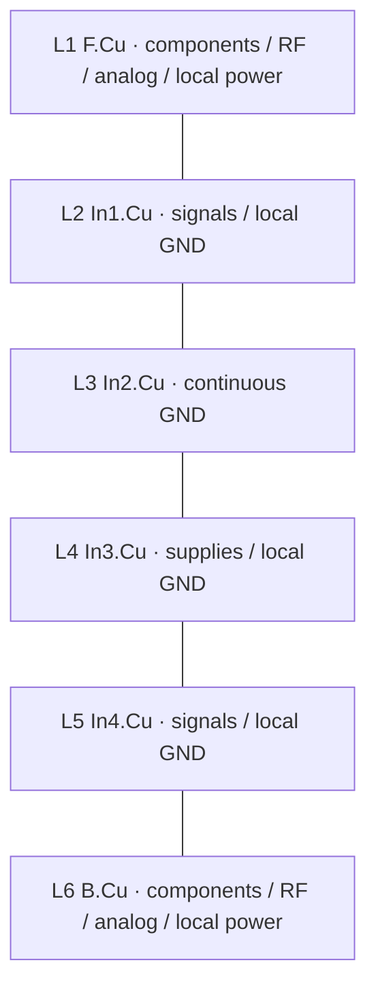

# OpenAIO-Whoop placement and routing reference

The schematic is the electrical source. The PCB contains the matching components,
net assignments, outline, stackup, local RF areas and routing rules. Inspect its
saved copper and native DRC before continuing a route; a floorplan or a local
route proof does not establish complete routing or manufacturing readiness.

## Open the project

Keep the complete folder together. Open `hardware/OpenAIO-Whoop.kicad_pro` in
KiCad 10, then open the schematic and board from that project. Do not open a
child sheet as an independent project. `esc_channel.kicad_sch` is intentionally
instantiated four times.

| File or folder | Purpose |
| --- | --- |
| `hardware/OpenAIO-Whoop.kicad_sch` and all child `.kicad_sch` files | Complete hierarchical schematic |
| `hardware/OpenAIO-Whoop.kicad_pcb` | Synchronized placement and routed copper |
| `hardware/OpenAIO-Whoop.kicad_pro` | Electrical rules, classes, presets and library path variables |
| `hardware/OpenAIO-Whoop.kicad_dru` | Custom layer, RF and HDI rules; keep beside the project |
| `hardware/lib.kicad_sym` | Project component symbols |
| `hardware/lib.pretty/` | Project footprints |
| `hardware/lib.3dshapes/` | Project 3D models |
| `hardware/KiCad-Library/` | Pinned shared symbols, footprints and models |
| `hardware/sym-lib-table`, `hardware/fp-lib-table` | Project-local library registration |
| `hardware/bom_plan.json` | Generated component index, including MPNs and DNP flags |
| `firmware/` and `research/PINMAP.md` | Checked firmware bindings and pin map |

No global custom-library installation is needed. `OPENDRONE_LIB` resolves to
`${KIPRJMOD}/KiCad-Library`. A Git clone needs its submodule initialized; the
portable handoff includes the shared library files. Stock KiCad libraries are
provided by KiCad 10. Do not move `.pretty`, models or child sheets independently.

## Layer allocation

| Physical layer | KiCad name | Use |
| --- | --- | --- |
| L1 | F.Cu | Top parts; RF, video, gyro and sense traces; short local power loops; digital escapes |
| L2 | In1.Cu | Digital, gate and BEMF routing with local GND pours; continuous GND under outer RF, USB and video |
| L3 | In2.Cu | Main GND reference plane; only the named HD_EN and UART0_TX bridges below; no non-GND zones |
| L4 | In3.Cu | Battery and regulated supply distribution; local GND reference regions; no signal or phase tracks |
| L5 | In4.Cu | Digital, gate and BEMF routing with local GND pours; continuous GND under outer RF, USB and video |
| L6 | B.Cu | Bottom parts; local RF, video and power loops; short digital connections |

GND zones alone belong on L2, L3 and L5. Keep uninterrupted local reference
copper on L2/L5 under each outer RF, USB and video route. Signal tracks on
those layers must avoid these reserved corridors. Do not run gate or other
switching traces beneath a gyro, oscillator or analog input. Use local GND
regions on L4 where a bottom inner signal needs a quiet nearby reference;
keep signal returns away from split supply boundaries.

Four named areas permit only 0.12 mm phase-sense pickup tracks:
`ESC1_PHASE_A_SENSE` and `ESC1_PHASE_B_SENSE` on In4, and
`ESC1_PHASE_C_SENSE` and `ESC4_PHASE_A_SENSE` on In1.
These connect the phase-voltage divider inputs and carry divider current.
Motor-current copper stays on the outer faces. The exception rejects other
nets, widths, layers, zones and any track extending beyond its named area.

`OSD_LVL_LOCAL` permits only the OSD divider's 0.12 mm In1 link.
`PA_DET_IN1_LOCAL` and `PA_DET_IN4_LOCAL` permit only the 0.12 mm detector
route on their named layers. The In4 portion has a connected local In3 GND
return; its shortened end preserves the ESC battery-entry widths. These
exceptions reject other nets, widths, layers, zone fills and tracks outside
their areas. Local pad/launch reference qualifications are recorded in
`hardware/validation/routing-checkpoint-2026-10-11.json`; they do not waive
RF reference requirements.

`VIDEO_IN_LOCAL_BRIDGE` permits one 0.15 mm video track on In1, spanning
1.273 mm over continuous In2 GND between two filled/capped laser vias.
This separates the camera video and 5 V crossings without moving the connector
or ESC gates. Its two outer launches have bounded adjacent-plane apertures;
motor-load and PWM-sweep video testing remains required.

`ADC_VBAT_IN1_LOCAL`, `ADC_VBAT_IN4_LOCAL`, `ADC_CURR_IN1_LOCAL` and
`ADC_CURR_IN4_LOCAL` permit only the respective 0.12 mm filtered ADC tracks.
The 318 Hz VBAT and 1.59 kHz current RC filters retain short local capacitor
returns. Their own buried-via antipads and short In4 portions over battery
copper are explicit low-bandwidth qualifications, not continuous In3 ground.
All exceptions reject other nets, widths, layers, zones and tracks outside
their named areas. RF references and Kelvin routing retain their restrictions.

`HD_EN_IN2_BRIDGE` permits only the 0.09 mm HD_EN control trace on In2,
within its enclosing local area. This 8.949 mm section is part of the
20.156 mm VTX power-enable connection. The native filled In2 ground remains
one connected island. Existing USB, gyro SPI, RF, video and oscillator
trace references retain their copper; the qualified XIN pad-edge aperture
increase is 0.002036 mm². Other nets, layers, widths and tracks leaving the
area remain errors. This local exception does not allow general In2 routing.

`UART0_TX_IN2_LOCAL` permits only the 0.09 mm UART0_TX trace on In2,
within its named area. This 5.836 mm bridge completes the 17.992 mm receiver
TX route with six vias and preserves the original GPIO16 assignment. The
filled In2 ground remains one island. USB, SPI, oscillator, RF and analog
reference projections are unchanged. Two short MOTOR1 crossings and one
UART0_RX crossing create 0.026449 mm² and 0.02439 mm² reference apertures;
these digital return-path tradeoffs require prototype signal verification.
The rule rejects other nets, widths, layers and tracks outside the area.

The nominal 1.0 mm stackup is in `hardware/tools/stackup.json`. Outer dielectric
spacing is 0.077 mm. The stored RF starting geometry is 0.105 mm trace / 0.15 mm
coplanar gap, and USB is 0.12 mm trace / 0.12 mm pair gap. These are design
calculations for the recorded stackup. Fabricator impedance adjustment must
use the actual finished copper and laminate construction.

## Place in this order

| Order | Block | Placement requirements |
| --- | --- | --- |
| 1 | Mechanical interfaces | Keep the 25.5 mm three-ear pattern and outline. Position motor lands J4/J7/J10/J13, USB J31, battery J2/J3, camera J32 and antenna interfaces for cable access. Reserve connector mating volumes on both faces |
| 2 | Four ESC cells | Keep each AGM210MAP and its 22 uF capacitor on the same face, with the three bridges grouped around their U6/U7/U8/U9 controller. Capacitors bridge source supply and ground at the package lead side. Keep gate loops short; phase copper exits toward the motor lands |
| 3 | Battery shunt and boost | J2 to R2 to the battery distribution should be short and wide. Take both sense traces from the Kelvin lands, outside load-current copper. Place U2/L1/input-output capacitors as a compact loop; keep SW copper small |
| 4 | Two RF chains | Keep U18 to FL1 to AE1 on one face with no RF vias. Keep U19/C110 to U20 to FL2 to J1 on one face. Rotate the whole chain for straight short links; do not retain a parked opposite-face U.FL position |
| 5 | FC and gyro | Place U10 centrally enough to reach the ESCs and peripherals. Place U11 away from boost, PA and motor current, with local C137/C138 and U12/C61/C62. Record the sensor orientation before building final firmware |
| 6 | Receiver and clocks | Keep U16 near U18 with short SPI. Keep X3 and its coupling parts beside U18. Keep X4/C94/C95 beside U19. Keep X1 beside U10 XIN. Optimize the Wi-Fi antenna pocket and feed for density; compact trial clearances need measured tuning and Wi-Fi verification |
| 7 | Video | Place R51/C66 at camera entry; U14 close to the VTX video network. Place U15 with R55/C67/C68/D3 as a compact sync branch; C70 bypasses U14 and C71 bypasses U15, each with short supply/ground connections. Keep video and sync inputs away from SW, phase copper and ESP clock routes |
| 8 | Remaining support | Retain U24 north of U10 on B.Cu with C143/C144 at its rail pins; route its four ordered channels to the mapped GPIOs. Put U4 and its fitted bypass parts/D11 together; D10 connects the boost bulk capacitors to this local regulator input. Place blackbox U13 and decoupling near SPI0; finish indicators, boot button and test access |

Read device rotations and pad coordinates from the saved board. The
[pin map](PINMAP.md#5-peripheral-allocation) groups each interface.
Preserve the gyro's MOSI11/MISO12/SCK14/CS15
order: it follows U11's actual pad arrangement. Receiver UART0 uses GPIO16/17
on the south edge toward U16. HD UART1 uses GPIO24/25 on the east edge toward
J28/J29. LED strip output uses GPIO29 beside its pad; GPIO18 is unused. GPIO4–7 carry motors 4, 1, 2 and 3. U24 channels A2/B2 and A0/B0
carry motors 1 and 3 respectively, shortening the ESC output routes while
retaining the four physical motor identities. Flash uses SPI0 MISO0/SCK2/MOSI3
and software CS19; HD_EN uses GPIO1. The CS/permission swap reuses the existing
CS approach to the flash while preserving all hardware SPI data bindings.
Moving or rotating U10 substantially changes
these placement advantages.

The component index groups every reference by schematic block. Schematic
proximity is not PCB proximity: each named local bypass must reach its device
pin without a long shared supply trace. Do not put a single remote capacitor
at the center of several ICs and treat it as their high-frequency bypass.

R2's 0.5 mOhm / gain-100 path produces 50 mV/A. The shunt's power and copper
thermal limits still apply. Netclass widths are routing minima, not current
ratings. Battery and motor phase paths need broad copper and enough parallel
vias for their actual current. Keep the four phase return loops separate from
the gyro and video ground paths while retaining a continuous ground reference.

## HDI escapes

Use only these via spans:

| Span | Type | Pad / drill |
| --- | --- | --- |
| F.Cu to In1.Cu | Laser microvia | 0.25 / 0.10 mm |
| In1.Cu to In4.Cu | Buried mechanical | 0.35 / 0.15 mm; power preset 0.40 / 0.20 mm |
| In4.Cu to B.Cu | Laser microvia | 0.25 / 0.10 mm |

No through vias, F.Cu-to-In4.Cu microvias, or stacked laser/buried drills.
Use filled and capped via-in-pad where required by the assembly land.

For a plane-only L2 escape, a 0.25 mm laser land and 0.35 mm buried land with
centers 0.25 mm apart overlap by 0.05 mm. Their drill edges remain 0.125 mm
apart. The shared copper land joins them without an L2 track. This exact
geometry was checked with KiCad connectivity and DRC. Keep the drills
staggered; the laser has its own landing and does not drill into the buried
hole. Beyond 0.30 mm centers the two circular lands no longer overlap.

U14 ground pin 2 uses a laser centre 0.025 mm south of the triangular pad
centre, with its buried mate 0.25 mm north. The checked hole-to-neighbour
copper gap is 0.18465 mm; the copper gap is 0.10965 mm. This small same-net
land extension avoids moving the comparator or routing a long ground return.
The ESP VTX DATA and CS signals use two filled laser lands inside the
package pad-ring gap because in-pad launches collide with the saved gyro
routes on In1. These exceptions keep the normal via diameters and clearances.

Check adjacent pad clearance and soldermask separately. A valid overlapping
via pair does not justify enlarging every fine-pitch pad. High-current paths
require several such connections or a deliberately sized copper transition,
not one minimum-size laser hole.

## Local areas before routing

Global `.kicad_dru` rules and the saved native RF areas work together.
Conditions using `intersectsArea(...)` become effective only when their named
area exists. Recheck the existing areas after any component move, and add the
remaining local reservations before routing through them:

- RF reference corridors beneath both chains, extending at least 0.5 mm beyond
  the RF copper/pads; keep reference-plane traces and non-GND vias out.
- The AE1 wire-root and exit clearance, plus AE2's selected trial window,
  ground terminal strip and tuning access. Antenna clearance may be reduced
  for density; RF performance requires a measurement on the assembled board.
- U.FL signal-pad reference cutout only where justified by its pad geometry;
  do not remove the whole RF ground plane.
- Boost inductor/SW clearance, Kelvin shunt corridor, connector mating areas,
  mounting-grommet and board-edge part clearance.

`hardware/tools/board_spec.json` retains legacy area geometry as a historical
placement reference. Do not apply those coordinates to the saved board.
Update the area specification to the accepted placement, then run the full
board-setup check. `setup_board.py` contains old floorplan coordinates and must
not be used to regenerate the board over a manual placement.

## Routing sequence and checks

Route local supply/bypass loops first, then RF, gyro/video/Kelvin signals and
USB, then clocks/SPI, DShot and other digital signals. Finish battery/phase
copper and ground stitching with thermal and return-path review. Recheck the
existing escape vias and their reference copper after any device movement.
Saved checkpoint checks apply only to the recorded board hash.

After placement, use KiCad's schematic-to-PCB update, refill zones and run DRC
with schematic parity enabled. Resolve out-of-outline pads, courtyard clashes,
mask bridges, illegal via spans, shorts and clearance violations. Unconnected
nets are expected until routing is complete. Do not hide those errors through
severity changes. Re-run the local rule parser and behavior checks after any
rule edit.

Before ordering, verify power-up/current, rail ripple, USB, both radio paths,
video and overlay levels, thermal behavior, motor dead time and bidirectional
telemetry on prototypes. This handoff establishes schematic/library consistency
and routing constraints; it does not establish measured flight readiness.

## External HD power access

J26 (VHD, +5V_BST) is on the back at (110.025, 124.17) mm, rotated 90 degrees.
Its 1.134 mm, 0.50 mm wide feed joins D10 pin 2 without vias. J27 ground and
J28/J29 UART pads remain on the front ledge. These wires leave from separate
locations; do not assume a contiguous four-pad connector. A 0.8 mm outer-diameter
wire can leave J26 toward the lower board edge with at least 0.330 mm package
clearance. Wire gauge, strain relief and installed-wire RF performance require
physical qualification. The back silkscreen identifies this pad as VHD.

C70 retains the mux bypass loop. The receiver shared VREG_RADIO tie uses a
regulated-power bridge while its two direct local SX1281 bypass stubs remain
on F.Cu. R61's 510 kOhm pull-up uses a 2.109 mm supply connection; the adjacent
PA detector dogleg stays on In1 over continuous In2 ground.

## Morning checkpoint

The final UART transition at 111.9,118.05 mm restores all 24 measured
battery-entry widths to the preceding accepted board. The discarded
112.65,118.8 mm transition is not in this file. Power/thermal validation
still requires a prototype; these are geometric checks only.

The native open connections are OSD_EN, OSD_W and CURR_SENSE. The saved
OSD_EN and current-monitor experiments were withheld because they cut
existing PA-detector or USB reference copper. The accepted board retains
the previous beeper GPIO20 binding.
